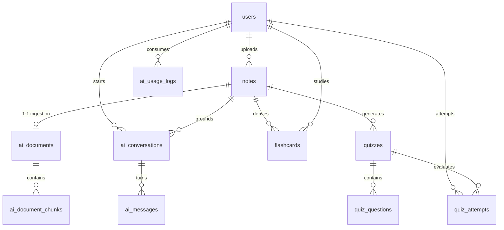

# PJ Study: Future AI Data Model Architecture Plan

## 1. Executive Summary & Philosophy

PJ Study's AI capabilities are designed around **document-grounded intelligence** (Retrieval-Augmented Generation / RAG) rather than generic ungrounded language generation. In future phases, students will converse with their study materials, generate structured flashcards, and take active recall quizzes directly tied to verified course notes.

To prevent premature complexity and migration friction, these tables are planned and documented here before implementation.

---

## 2. Planned AI Entity Specifications

### A. AI Document (`ai_documents`)

- **Purpose:** Represents the ingestion and vectorization status of an approved academic note PDF.
- **Fields:**
  - `id`: UUID (Primary Key)
  - `noteId`: Foreign Key $\rightarrow$ `notes(id)` (ON DELETE CASCADE, unique 1-to-1)
  - `status`: Enum (`PENDING`, `PARSING`, `INDEXED`, `FAILED`)
  - `parserVersion`: VarChar(50) (Tracks layout parser engine)
  - `embeddingModel`: VarChar(100) (e.g. `text-embedding-3-small` or local embedding)
  - `tokenCount`: Integer (Total tokens in document)
  - `chunkCount`: Integer (Total semantic chunks created)
  - `createdAt`, `updatedAt`
- **Relationship:** 1:1 with `Note`. Every AI document is grounded in an approved academic manuscript.

### B. AI Document Chunk (`ai_document_chunks`)

- **Purpose:** Granular semantic passages extracted from the note for vector indexing and citation matching.
- **Fields:**
  - `id`: UUID (Primary Key)
  - `aiDocumentId`: Foreign Key $\rightarrow$ `ai_documents(id)` (ON DELETE CASCADE)
  - `chunkIndex`: Integer (0-based order within document)
  - `pageNumber`: SmallInt (Source PDF page number for UI citation highlights)
  - `content`: Text (Extracted verbatim passage)
  - `tokenCount`: Integer
  - `embedding`: Vector or binary storage key (stored in external vector index or MySQL 9 vector column)
  - `createdAt`
- **Relationship:** N:1 with `AIDocument`. Enables students to click citations in AI responses and jump to the exact source page.

### C. AI Conversation (`ai_conversations`)

- **Purpose:** An interactive study thread between a student and one or more notes.
- **Fields:**
  - `id`: UUID (Primary Key)
  - `userId`: Foreign Key $\rightarrow$ `users(id)` (ON DELETE CASCADE)
  - `noteId`: Foreign Key $\rightarrow$ `notes(id)` (Optional: null for cross-subject study sessions)
  - `title`: VarChar(200) (Auto-generated or student-assigned)
  - `model`: VarChar(100) (LLM engine used)
  - `createdAt`, `updatedAt`
- **Relationship:** N:1 with `User`, N:1 optional with `Note`.

### D. AI Message (`ai_messages`)

- **Purpose:** Individual dialogue turns within a study conversation.
- **Fields:**
  - `id`: UUID (Primary Key)
  - `conversationId`: Foreign Key $\rightarrow$ `ai_conversations(id)` (ON DELETE CASCADE)
  - `sender`: Enum (`USER`, `ASSISTANT`, `SYSTEM`)
  - `content`: Text
  - `citations`: JSON (Array of cited `{ chunkId, pageNumber, snippet }`)
  - `tokenCount`: Integer
  - `latencyMs`: Integer (Telemetry)
  - `createdAt`
- **Relationship:** N:1 with `AIConversation`.

### E. Flashcard (`flashcards`)

- **Purpose:** Spaced-repetition active recall study cards.
- **Fields:**
  - `id`: UUID (Primary Key)
  - `noteId`: Foreign Key $\rightarrow$ `notes(id)` (ON DELETE CASCADE)
  - `userId`: Foreign Key $\rightarrow$ `users(id)` (Author/owner)
  - `front`: Text (Question / Prompt / Formula)
  - `back`: Text (Answer / Explanation)
  - `sourcePage`: SmallInt (Optional citation)
  - `interval`: Integer (Spaced repetition interval in days, e.g. SM-2)
  - `easeFactor`: Decimal(4, 2) (SuperMemo algorithm multiplier)
  - `nextReviewAt`: DateTime (Scheduled recall date)
  - `createdAt`, `updatedAt`
- **Relationship:** N:1 with `Note`, N:1 with `User`.

### F. Quiz, Quiz Question & Quiz Attempt

1. **Quiz (`quizzes`):**
   - Fields: `id`, `noteId`, `title`, `description`, `timeLimitMinutes`, `difficulty`, `createdById`, `createdAt`
   - Relationship: N:1 with `Note`, N:1 with `User`.
2. **Quiz Question (`quiz_questions`):**
   - Fields: `id`, `quizId`, `question`, `options` (JSON), `correctIndex`, `explanation` (Text), `sourceChunkId`
   - Relationship: N:1 with `Quiz`.
3. **Quiz Attempt (`quiz_attempts`):**
   - Fields: `id`, `quizId`, `userId`, `score` (Decimal), `answers` (JSON), `completedAt`, `createdAt`
   - Relationship: N:1 with `Quiz`, N:1 with `User`.

### G. AI Usage Log (`ai_usage_logs`)

- **Purpose:** Rate limiting, quota enforcement, and cost monitoring.
- **Fields:**
  - `id`: UUID (Primary Key)
  - `userId`: Foreign Key $\rightarrow$ `users(id)` (ON DELETE CASCADE)
  - `operation`: VarChar(50) (e.g. `CHAT_QUERY`, `SUMMARY_GEN`, `FLASHCARD_GEN`, `EMBEDDING`)
  - `promptTokens`: Integer
  - `completionTokens`: Integer
  - `totalTokens`: Integer
  - `estimatedCost`: Decimal(10, 6)
  - `createdAt`: DateTime
- **Relationship:** N:1 with `User`. Enforces student daily query quotas and tracks token consumption.

---

## 3. Entity Relationship Diagram (Future AI Extension)

